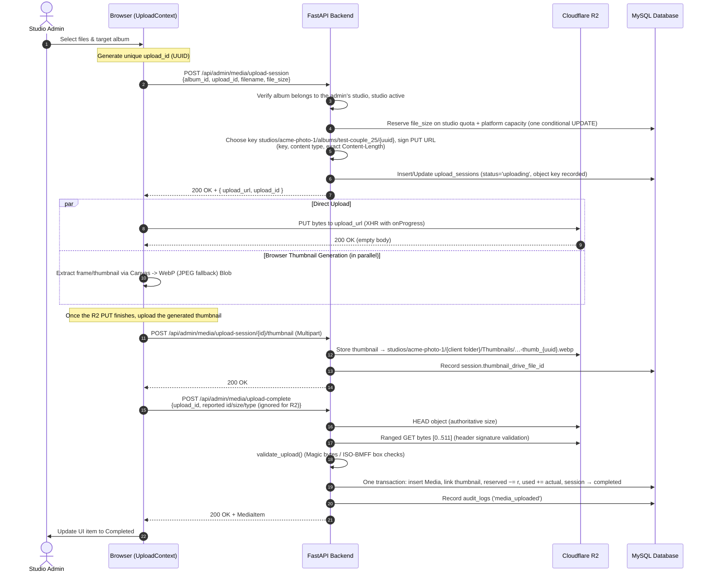

# Architecture: Media Storage & Upload Pipeline

This document details the architecture, design decisions, end-to-end data flow, and error-handling mechanisms for media uploads and storage in **LoveStory PH**.

Related: `STORAGE_STRUCTURE.md` (where every file lives), `MULTI_STUDIO.md` §5 (quota enforcement), `ARCHITECTURE.md`.

> **v0.5 (31/10/2026) — storage backend:** media now goes to **Google Drive** by default (`STORAGE_PROVIDER=google_drive`, implemented in `backend/app/services/google_drive_service.py`); R2 is still available with `STORAGE_PROVIDER=r2`. On Drive the backend opens a resumable upload session (`create_resumable_session`) and the browser PUTs the bytes to it; the PUT response carries the file `id`, which `adminService.uploadToDrive` reports to `POST /upload-complete`. The backend then verifies it with Drive (`get_file`, upload-id tag in `appProperties`, header signature) before creating the Media row. R2-specific text below (presigned URLs, server-chosen keys, bucket CORS) applies only when `STORAGE_PROVIDER=r2`.

---

## 1. Executive Summary

Media files (high-resolution wedding photos and large video files up to 10 GB) are stored in **Cloudflare R2**, in a single private bucket. Every object key starts with the studio's own readable folder, `studios/{studio-name}-{studio_id}/` (e.g. `studios/acme-photo-1/`), so each studio's files are isolated under their own prefix.

To prevent bandwidth saturation, server memory exhaustion, and long-running HTTP request timeouts on the application server, the platform implements a **Direct-to-R2 Presigned Upload Architecture**:

- **Zero VPS Relay**: The browser transfers raw file bytes directly to R2 with a short-lived presigned `PUT` URL. No multi-GB payload ever passes through the backend server's disk or network interface.
- **Backend Session Coordination**: The backend authenticates the studio admin, reserves the file's size against the studio's storage quota, chooses the object key, signs the URL (key, content type and exact `Content-Length`), maintains an idempotency ledger in MySQL (`upload_sessions`), validates the stored file, and completes DB persistence.
- **Client-Side Thumbnail Extraction**: Poster frames for videos and downscaled thumbnails for photos are generated in the browser using HTML5 Canvas and WebP compression, eliminating server-side FFmpeg processing and avoiding costly re-downloads of video files.
- **Global Upload Persistence**: Upload state is managed via React Context (`UploadContext`), allowing admins to navigate freely between admin pages while transfers continue seamlessly in the background, monitored by a global floating status badge.

> Naming note: some identifiers still carry the earlier Google Drive names (`uploadToDrive`, `driveFileId`, `drive_file_id`, `drive_folder_id`, `UploadContext`'s "direct-to-Drive" comments). They are historical; with R2 they hold the R2 object key / key prefix.

---

## 2. System Components

### 2.1 Backend Services & Handlers

| Component | File Path | Responsibilities |
|---|---|---|
| **Admin Media Routes** | `backend/app/api/admin_media.py` | API endpoints for session creation, progress reporting, thumbnail attachment, completion confirmation, and abandonment. |
| **Media Service** | `backend/app/services/media_service.py` | Business logic for validating upload intent, reserving quota, opening the upload session with the storage provider, validating file headers via ranged reads, managing session state transitions, and creating `Media` records. |
| **Quota Service** | `backend/app/services/quota_service.py` | Atomic reserve / commit / release of the studio's and the platform's storage counters (see `MULTI_STUDIO.md` §5). |
| **R2 Storage** | `backend/app/services/r2_storage.py` | The only storage implementation in use (boto3 against R2's S3 API): presigned `PUT` URLs, ranged reads, delete, key-prefix listing, `put_bytes` for small server-made objects such as studio logos. Credentials come only from server-side environment variables; the frontend never sees them. Failures are logged with R2's own error code (e.g. `AccessDenied`, `NoSuchBucket`) and surfaced to the browser as a generic 502. |
| **Storage interface & provider** | `backend/app/services/storage_service.py` `backend/app/services/storage_provider.py` | Abstract `StorageService` and the dependency that returns the process-wide `R2Storage`. Key seams: `object_key_for()` (server chooses the key), `owns_object()` (tenant check), `tenant_root_folder()` (parent prefix for a studio's client folders). |
| **Thumbnail Worker** | `backend/app/workers/thumbnail_worker.py` | Normalizes browser-submitted WebP thumbnails; provides optional fallback image downscaling and server-side FFmpeg poster extraction for backfill scripts. |
| **Upload Session Model** | `backend/app/models/upload_session.py` | MySQL `upload_sessions` table acting as an idempotency ledger with fields: `admin_id`, `studio_id`, `upload_id`, `album_id`, `filename`, `total_bytes`, `bytes_uploaded`, `status`, `drive_file_id` (holds the R2 object key), `thumbnail_drive_file_id`, `reserved_bytes`, `reservation_status`, `media_id`, `error_code`, `error_message`. |
| **Orphan & quota reconciliation** | `backend/app/services/orphan_reconciliation.py` `backend/app/services/quota_reconciliation.py` | Cron jobs: delete objects of uploads that never completed; recompute and repair usage counters. |
| **Legacy Google Drive code (dormant)** | `backend/app/services/google_drive_service.py`, `circuit_breaker.py`, `retry.py`, `thumbnail_folder_migration.py` | Kept in the repository from the Drive era. Nothing selects them, and no Drive configuration is read. |

### 2.2 Frontend Components & Utilities

| Component | File Path | Responsibilities |
|---|---|---|
| **Upload Context** | `frontend/src/contexts/Uploadcontext.tsx` | Global React context holding upload queue state, scheduling concurrent uploads (max 4), tracking progress, retrying, and managing `File` memory cleanup. |
| **Uploads Page** | `frontend/src/pages/Uploads.tsx` | UI interface for drag-and-drop file selection, client and album targeting, upload progress bars, error notifications, and batch actions. |
| **Global Upload Badge** | `frontend/src/components/Globaluploadbadge.tsx` | Floating UI badge rendered across all admin routes when uploads are active in the background. |
| **Video Poster Utility** | `frontend/src/utils/videoPoster.ts` | Uses `<video>` and `<canvas>` to capture a frame near 1s (or the midpoint for short clips), scans later frames when the first is dark, and exports WebP (JPEG fallback). |
| **Photo Thumbnail Utility** | `frontend/src/utils/photoThumbnail.ts` | Uses `Image` and `<canvas>` to downscale photos to $\le 400\text{px}$ WebP thumbnails. |
| **Admin API Service** | `frontend/src/services/admin.ts` | `createUploadSession`, `uploadToDrive` (an `XMLHttpRequest` `PUT` of the file to the presigned R2 URL, with progress events), `uploadThumbnail`, `completeUpload`, `abandonUploadSession`. R2 answers a successful `PUT` with an empty body, so nothing is parsed from it: the server already knows the key it issued and re-reads size and type from R2 at confirmation. |

---

## 3. End-to-End Upload Sequence

The bucket must have a CORS rule allowing the frontend origin to `PUT` (README, Setup step 4); otherwise step 2 fails in the browser with a CORS error before any byte is sent.

---

## 4. Key Architectural Mechanisms

### 4.1 Server-chosen Keys, Signed Size and Tenant Prefix

Direct browser uploads must not let a browser decide where its bytes go.

1. At `POST /upload-session` the server picks the object key itself: `{studio folder}/albums/{client-name}_{album_id}/{media_uuid}` (e.g. `studios/acme-photo-1/albums/test-couple_25/<uuid>`; studios that predate readable folders use `studios/{id}/albums/{album_id}/{media_uuid}`). The studio comes from the authenticated admin row, never from the request.
2. The presigned URL is valid for `R2_PRESIGN_TTL_SECONDS` (default 900), for that one key, with the content type and the **exact `Content-Length`** that was reserved against the quota signed into it. R2 rejects a body whose length differs, so a browser cannot upload more than it reserved.
3. The key is recorded on the session row immediately. At `POST /upload-complete` the server uses that recorded key and ignores whatever id the browser reports; `owns_object()` additionally refuses any key that is not under the studio's own folder.
4. Files over 5 GiB would need multipart upload, which is not implemented; they are refused with a clear error.

### 4.2 Client-Side Thumbnail Generation

Generating video poster frames on a VPS server typically requires downloading multi-gigabyte video files back from storage into server memory/disk and running FFmpeg.

To eliminate this bottleneck:
1. **Video Poster Extraction (`videoPoster.ts`)**: When a video is queued, a hidden 1×1px `<video>` element is **attached to the document** (off-screen, `opacity: 0.01`) with `URL.createObjectURL(file)`. The element must be in the DOM — browsers only *paint* frames for rendered media, so a detached element draws black. With `preload="auto"` it seeks to a position, then plays muted while waiting for `requestVideoFrameCallback` (a frame the decoder actually delivered), pauses, and draws to an HTML5 `<canvas>` as `image/webp` (quality 0.80, max dimension 720px; JPEG fallback when WebP encoding is unavailable). It starts near 1s (the midpoint for clips under 2s); if that frame is dark, it scans 25%, 50% and 75% of the clip and keeps the brightest frame. A never-decoded, solid-black frame (luma ≤ 4) is never stored — the utility returns `null` instead.
2. **Photo Thumbnail Downscaling (`photoThumbnail.ts`)**: For high-resolution photos, an `Image` object renders to canvas and scales down to $\le 400\text{px}$ WebP (JPEG fallback if WebP encoding fails); source images over 50 megapixels are skipped.
3. **Upload via Session Hook**: Once the R2 PUT finishes, the browser uploads the lightweight WebP blob (~10–150 KB) to `POST /api/admin/media/upload-session/{upload_id}/thumbnail`. The server re-encodes it and writes it to R2 itself.
4. **Where they are stored**: both the video poster and the photo thumbnail are written under the client's single dedicated **`Thumbnails`** prefix: `{studio folder}/{client folder}/Thumbnails/…-thumb_{uuid}.webp`. That prefix is created lazily once per client and recorded on `clients.thumbnail_folder_id`, so a retry after a failed thumbnail upload reuses it. Thumbnails belong to the client, not to an album, so they stay in place when a photo moves between albums. They are not counted in the studio's quota (`Media.file_size` is the original only).
5. **Best-Effort Resiliency**: Extraction and upload are best-effort, with 15–20-second timeouts. If the browser or client codec fails to extract a frame (or only produces black), nothing is stored and the main upload continues unimpeded. The gallery grid gracefully falls back to a placeholder tile.

### 4.3 Idempotency Ledger & Upload Session Lifecycle

The `upload_sessions` table ensures crash recovery, deduplication, and retry granularity:

- **Idempotency Key (`upload_id`)**: A unique UUID generated by the frontend. Crucially, the filename is omitted from the ID string, preventing `VARCHAR(100)` DB column overflow on long filenames.
- **Session States**:
  - `queued`: Session reserved, awaiting client transfer.
  - `uploading`: Presigned URL issued; client transfer in flight.
  - `completed`: Upload confirmed and `Media` record created.
  - `failed`: Terminal failure with `error_code` and `error_message`.
  - `cancelled`: Explicitly cancelled by user via `abandon_direct_upload()`.
- **Replay Safety**: If a client re-submits an `upload_id` that is already `completed`, the server immediately returns the existing `Media` record without initiating a duplicate upload.
- **Two-Phase Guarantee**: The object key is on the session row from the moment the session opens, and again checkpointed before header validation during `complete_direct_upload`. If validation fails or a crash occurs, the key is on record, so orphan cleanup can reclaim the object — including when the browser's confirmation never arrives (closed tab).
- **Quota reservation state** (`reservation_status`: `none → reserved → committed | released`) is compare-and-set, so completion, failure, cancellation and the stale sweep can each release or commit it only once.

### 4.4 Ranged Read Header Validation

The server never trusts client-reported MIME types or file contents. However, downloading entire multi-gigabyte files to verify magic bytes would undermine the direct upload design.

Instead, during `complete_direct_upload`:
1. The backend asks R2 for the object's metadata (authoritative size; a missing object fails the session with `UPLOAD_NOT_FOUND_IN_STORAGE` after a few short retries) and then issues an HTTP Range request (`storage.download(key, range_start=0, range_end=511)`).
2. `validate_upload()` verifies:
   - Image magic signatures (JPEG SOI, PNG header, WebP RIFF).
   - Video container validation: Walks ISO-BMFF boxes (`ftyp`, `moov`, `mdat`) for MP4 and QuickTime MOV containers.
3. If signatures do not match the declared extension, the object is deleted immediately, its reservation is released and an error is returned. An object larger than the maximum upload size is deleted the same way.

### 4.5 Concurrency & Memory Management

- **Queue Throttling**: The frontend scheduler restricts active concurrent uploads to `MAX_CONCURRENT_UPLOADS = 4` to prevent saturating client uplink bandwidth and browser connection pools.
- **DOM/Memory Release**: Once a file finishes uploading or is cancelled, `withReleasedFile()` nullifies the `File` reference in the React state. This prevents hundreds of megabytes of binary buffers from being pinned in browser heap memory during large batches.
- **Global Upload Context**: Managed by `UploadContext.tsx`. State is mounted at the root admin provider level, ensuring route transitions do not interrupt ongoing XHR requests.
- **Global Status Badge**: `GlobalUploadBadge.tsx` displays active upload counts, progress percentage, and spinning indicators across all admin screens.
- **No server-side transfer limits needed**: because bytes never reach the server, the former admission-control settings of the Drive era (`UPLOAD_MAX_CONCURRENT`, chunk size, retry/backoff, per-chunk timeouts) no longer apply.

### 4.6 Concurrent Confirmation & Retry Recovery

Multiple files finishing around the same time run up to `MAX_CONCURRENT_UPLOADS` confirmation requests (`POST /upload-complete`) concurrently. Each one re-reads the just-uploaded object from R2 (metadata + a ranged header read-back) before creating the `Media` row, in one transaction that also moves the quota from *reserved* to *used*. Two failure modes specific to this stage are handled:

- **Post-PUT propagation tolerance**: the metadata lookup retries a `404`/not-visible response a few times with a short delay (`UPLOAD_CONFIRM_404_RETRIES` in `media_service.py`) before the session is condemned as `failed`.
- **Retry never dead-ends**: if a previous confirmation attempt still burned the session to `failed`, calling `/upload-complete` against it would otherwise 409 forever ("This upload session is 'failed', not awaiting completion."). `retryCompleteOnly` detects that `UPLOAD_NOT_IN_PROGRESS` response and falls back to `startUpload`, which re-opens the failed session under the *same* `upload_id` for a fresh upload — a burned batch stays recoverable instead of being permanently stuck.

### 4.7 Quota and Studio-status Errors on Upload

Starting an upload can be refused before any URL is issued; the Uploads page shows the reason from the ledger row:

| HTTP | Code | Meaning |
|---|---|---|
| 413 | `STUDIO_QUOTA_EXCEEDED` | The file does not fit in the studio's remaining quota (quota − used − reserved) |
| 507 | `PLATFORM_CAPACITY_EXCEEDED` | The platform's total capacity is exhausted |
| 403 | `STUDIO_SUSPENDED` | The studio is suspended (reads still work, writes do not) |
| 502 | `STORAGE_SESSION_FAILED` | R2 could not sign/open the session (check the server log for the R2 error code) |

### 4.8 Removed: the automatic client cover

An earlier version of this pipeline gave each client one cover image for the gallery landing page. It no longer exists, and nothing in the upload path replaced it — the sequence above is the whole story.

- **What it was**: the first eligible photo to finish uploading while the client had no cover. The browser rendered a $\le 1600\text{px}$ WebP from the same local file and sent it to a `…/cover` endpoint after `/upload-complete`.
- **Why it went**: it was a second, parallel set of cover bytes — a second storage location, a second compare-and-set race, two extra columns, and two extra endpoints — all to produce an image the item's own thumbnail already provided.
- **What replaced it**: nothing in the pipeline. Album art is now derived at read time — the gallery grid takes the first item of each album and uses its thumbnail (`Gallery.tsx`; a styled empty cover block is shown when no thumbnail exists). See `ARCHITECTURE.md` § *Album Covers*.
- **Removed with it**: `cover_service.py`, the `clients.cover_drive_file_id` column, `has_cover` on the gallery-info response, and the `cover_needed` flag on the session response (Alembic `a5c7e3b1d9f8`). The one-off `migrate_thumbnail_folders.py` only matters for installations that stored data in Google Drive; a fresh R2 installation never has the legacy folders.

---

## 5. Failure Recovery & Edge Cases

| Scenario | Handled By | System Behavior |
|---|---|---|
| **User navigates away from `/admin/uploads`** | `UploadContext` | Upload continues in background; `GlobalUploadBadge` displays live progress. |
| **User cancels upload** | `abandonUploadSession` | In-flight XHR is aborted; backend marks session `cancelled`, releases the quota reservation and frees the ledger slot. |
| **Browser PUT is blocked (CORS)** | Bucket CORS policy | The browser reports a network/CORS error; the item is marked failed, the session is abandoned (reservation released) and a retry reopens it. Fix: add the frontend origin to the bucket's CORS rule. |
| **Upload succeeds, but confirm fails** | `retryCompleteOnly` + recovery | Frontend keeps the "already uploaded" marker and first retries only the confirmation step (no byte re-transfer). If that fails with `UPLOAD_NOT_IN_PROGRESS` (a prior attempt burned the session to `failed`), it falls back to re-opening a fresh session under the same `upload_id` and re-uploading instead of dead-ending. |
| **Browser tab closed mid-upload** | Session recovery | On reload, incomplete sessions are retrieved via `GET /upload-sessions` and surfaced as failed (since browser `File` object cannot be restored). |
| **Server restart while uploads in-flight** | Lifespan Startup Sweep | `app/main.py` scans for lingering `uploading`/`queued` sessions and marks them `failed` (`UPLOAD_STALE`), releasing their reservation. |
| **Unfinished reservation never released** | `reconcile_quota` | Recomputes counters from the database and releases reservations older than `UPLOAD_RESERVATION_TTL_MINUTES` (default 120). |
| **Object in R2 without a Media row** | `reconcile_orphans.py` | Cron identifies objects of sessions that never completed (past `ORPHAN_FILE_GRACE_PERIOD_HOURS`) and purges them. |
| **R2 token without write permission** | `scripts/check_r2.py`, server log | Signing a URL needs no network call, so the session opens, but the browser's PUT is refused with 403, and server-side writes (thumbnails, studio logos) fail with 502; the log line `R2 <operation> failed: … code=AccessDenied` names the cause. Use an R2 token with Object Read & Write. |
| **Thumbnail upload fails** | Best-effort (§4.2) | The main upload is unaffected. The session keeps no `thumbnail_drive_file_id`; the gallery grid falls back to a placeholder tile for that item. The `Thumbnails` prefix is recorded anyway, so a retry reuses it. |
| **Photo or album deleted** | `media_service` / album and client services | The original and its thumbnail are removed from R2 first; usage is decreased only after the storage delete succeeded. |
